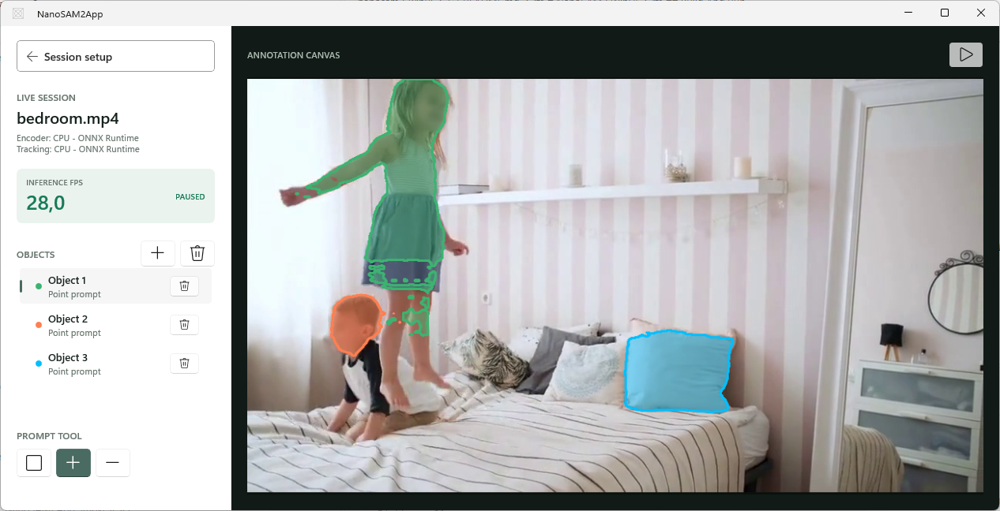

# NanoSAM2 WinUI

A native C# / WinUI 3 application for local [Nanosam2](https://github.com/paspf/nanosam2) video segmentation using a C# port of the Nanosam2 ONNX Camera Predictor. Inference uses the Windows ML runtime distributed with the Windows App SDK, with `Microsoft.ML.OnnxRuntime` sessions and `Microsoft.Windows.AI.MachineLearning.ExecutionProviderCatalog`. It does not use the legacy `Windows.AI.MachineLearning` API or require Python at runtime.



## Build And Run

Developed for Windows 11 x64, .NET SDK 10, and the `winapp` CLI. Visual Studio is not required. Enable Windows Developer Mode for debug package registration. Vendor GPU/NPU providers can additionally require Windows 11 24H2 or newer and current device drivers.

```powershell
winget install Microsoft.DotNet.SDK.10
winget install Microsoft.WinAppCLI
```

From this directory:

```powershell
dotnet build .\NanoSAM2App\NanoSAM2App.csproj
winapp run .\NanoSAM2App\NanoSAM2App.csproj
```

Command `winapp run` builds, registers and runs a development package with the identity needed by WinUI and Windows ML. Dependencies, including OpenCvSharp's native Windows runtime, are restored by NuGet. 

### Release Builds

From the nanosam2-winui directory, build an x64 Release version:

```powershell
dotnet build .\NanoSAM2App\NanoSAM2App.csproj -c Release -r win-x64 -p:Platform=x64
```

To build and run it with the required package identity:
```powershell
winapp run .\NanoSAM2App\NanoSAM2App.csproj -c Release --arch x64
```

The output can be found under `NanoSAM2App\bin\x64\Release\net10.0-windows10.0.26100.0\win-x64\`.

In order to create an installable `.msix` package, first create an unsigned x64 MSIX, then bundle it using your installed Windows SDK:

```powershell
# Create artifacts directory
New-Item -ItemType Directory -Force .\artifacts\bundle-input | Out-Null

# Package app for x64
winapp pack .\NanoSAM2App\NanoSAM2App.csproj -c Release --arch x64 --no-sign --output .\artifacts\bundle-input\NanoSAM2-x64.msix 

# Bundle all compiled archs into a single package
& "C:\Program Files (x86)\Windows Kits\10\bin\10.0.22621.0\x64\MakeAppx.exe" bundle /d .\artifacts\bundle-input /p .\artifacts\NanoSAM2.msixbundle /o
```

Sign the bundle with your certificate:

```powerhell
winapp sign .\artifacts\NanoSAM2.msixbundle .\signing.pfx
``` 


## Model Bundle

Select a folder containing exactly one exported model family. Required files are:

```text
<prefix>-image-encoder-sa1-*-op24.onnx
<prefix>-sam-heads-sa1-*-op24.onnx
<prefix>-memory-encoder-sa1-*-op24.onnx
<prefix>-memory-attention-sa1-*-op24.onnx
<prefix>-constants.npz
```

Keep every companion `.onnx.data` file alongside its ONNX file. The app prefers the highest numeric opset when multiple exports exist. A legacy mask-decoder-only bundle is not sufficient.

Export the full SAM heads and memory-attention model with the `rope_k_mask` input, for example, from the sibling [Nanosam2](https://github.com/paspf/nanosam2) repository. The export with ResNet50 backend and 512px is strongly recommended.

```powershell
python tools/onnx_export.py --encoder_type resnet18-512 --checkpoint weights/nanosam2-resnet18-sa1-v01.pth --export all --output_path onnx_export_resnet_512 --opset 24
```

The encoder must have a fixed square input, divisible by 16; its size is read from model metadata. The predictor supports the repository's standard batch-one export, seven spatial memory slots, up to sixteen object pointers, and memory-mask sigmoid scale/bias of `20/-10`. Constants must be float32 NumPy arrays. Custom SAM2 configurations with different memory semantics are not supported automatically.

## Use In Other C# Apps

Reuse the model bundle above and these source files; WinUI is not required:

- [NanoSAM2App/ModelBundle.cs](NanoSAM2App/ModelBundle.cs): finds the ONNX blocks and reads constants; includes `FloatTensor`.
- [NanoSAM2App/NanoSamTracker.cs](NanoSAM2App/NanoSamTracker.cs): image preprocessing, segmentation, and independent object tracking/memory.
- [NanoSAM2App/HardwareChoice.cs](NanoSAM2App/HardwareChoice.cs): optional device discovery and ONNX Runtime session configuration.

For Windows x64, reference `Microsoft.Windows.AI.MachineLearning`, `OpenCvSharp4`, and `OpenCvSharp4.runtime.win`. Load with `ModelBundle.Load`, create `NanoSamTracker` with encoder/tracking session options, then call `SetFrame`, `AddObject` for prompts, `Track` on subsequent frames, and `Masks` for mask logits. Dispose the tracker when finished.

## Hardware Selection

Image encoding and the remaining model blocks have independent device selections:

- **Image encoder:** one encoding pass per frame, shared by all objects.
- **SAM heads + memory:** SAM heads, memory encoder, and memory attention, each executed separately for each tracked object.

Unsupported operators can still be assigned to CPU; choosing a GPU/NPU does not guarantee that the entire graph runs there. Load failures are shown rather than silently switching the selected hardware.

DirectML always uses sequential execution and disabled memory patterns, as required by its execution provider. It is possible to **Enable DirectML graph optimizations**. CPU and other providers are unaffected. on Intel Graphics DirectML graph optimizations may lead to errors.

## Use and Function

1. Choose or type the model folder, select hardware for both components, and select a video file or webcam. Camera capture uses the selected Windows device ID. Denied camera access may require enabling camera access in Settings.

2. Click **Next**. Use the rectangle tool to create an object, or the new-object plus button followed by a positive dot. Clicks outside the image are ignored.

3. Select an object in the list to add positive or negative points. Negative points require an existing object. Point corrections reinitialize that object's memory on the displayed frame; they do not pass the previous mask into SAM heads. Prompt history is retained only while staying on that frame.

4. Use play/pause to advance tracking. Additional objects can be introduced on later paused frames. Colors identify independent objects. The sidebar shows measured inference FPS.

5. Use an object's bin to remove only that object, or the top bin to clear all objects and memory. 

Each object's rolling history retains fifteen prior pointer frames while only the six most recent non-conditioning spatial frames feed attention.
